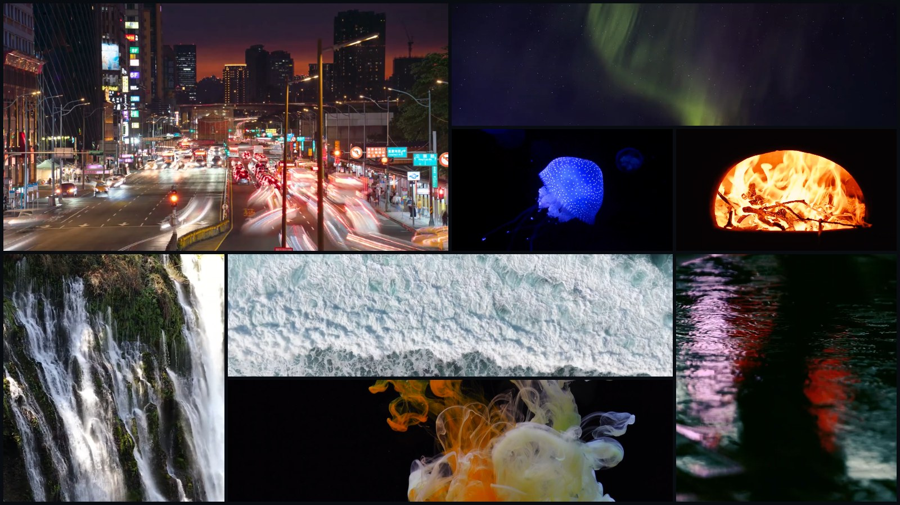
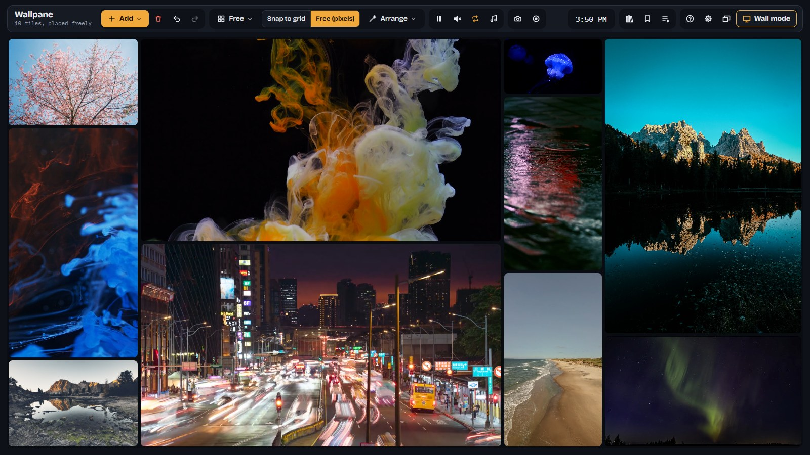
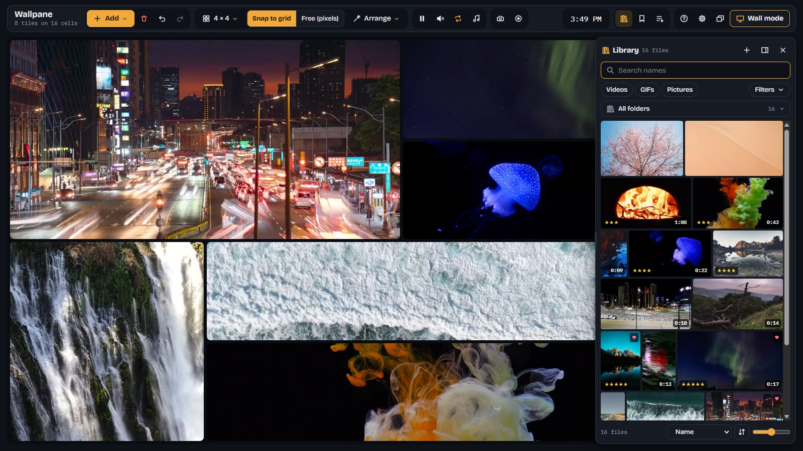
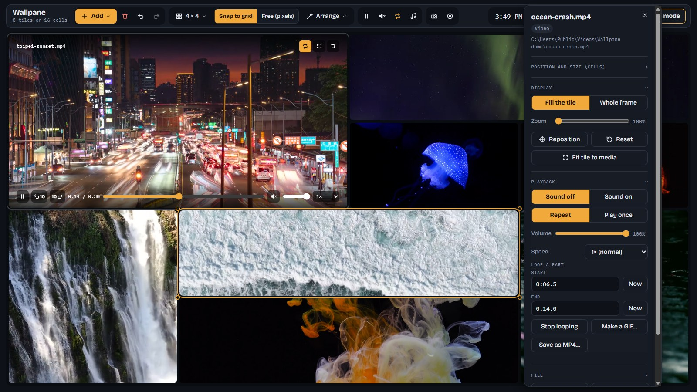

<h1 align="center">Wallpane</h1>

<b>Your own videos, pictures and GIFs, many at once, on a wall that fills the screen.</b> 
Free for Windows. Everything stays on your PC: Wallpane never goes online.

<a href="https://github.com/VPTaurus/Wallpane/releases/latest"><b>Download for Windows</b></a> &nbsp;·&nbsp; <a href="docs/guide.md">Guide</a> &nbsp;·&nbsp; <a href="CHANGELOG.md">What's new</a>

## What it does

**Arrange the wall your way.** Snap tiles to a grid, or place and size them freely by the pixel. Drop files or whole folders from Explorer, drag a tile's edges to resize it, and Fill the wall turns everything into a collage in which each file keeps its own shape. Ready-made layouts, your own, and undo for all of it.

**Play folders, and your library.** A tile can play a whole folder in turn, with its own timing, order and crossfade, and new files join as they appear. The library shows every file in your folders as a thumbnail, with search, filters, stars, a favourite heart and tags; drag files onto the wall, or play a collection.

**Fine-tune every tile.** Zoom and frame what each tile shows, loop a part of a video, change its speed and volume, all in one card. Videos that don't play as they are (AVI, WMV and more) are converted for you, with the FFmpeg inside Wallpane.

**Run a wall on its own.** Wall mode (F11) shows only the wall, on the display you pick, also a TV or projector. With Start with Windows, a wall comes back full screen after a restart, and keeps the display awake.

**Record it, share it.** Record the wall as it plays and stop when you like; take a screenshot; save a looped part as a GIF or MP4, or a frame as a picture. Background music can play behind it all.

**Private.** Wallpane plays your local files only and never connects to the internet; your files are never changed. One key (or mouse button) hides every wall window at once, from any program.

## Download and install
1. Get **Wallpane Setup** (installer) or **Wallpane** (portable, no install) from the [latest release](https://github.com/VPTaurus/Wallpane/releases/latest). For Windows 10 and 11, 64-bit.
2. Wallpane is not code-signed yet, so Windows SmartScreen may say "Windows protected your PC": click **More info**, then **Run anyway**.

It plays MP4, WebM, MOV, MKV and more, and JPEG, PNG, GIF, WebP and other pictures. See [Formats](docs/guide.md#formats).

## More
- [Guide](docs/guide.md): everything Wallpane does, with all its keys
- [What's new](CHANGELOG.md) and the [roadmap](ROADMAP.md)
- [Developing Wallpane](docs/development.md): run it from source, test, build and release

If Wallpane is useful to you, you can support it on [GitHub Sponsors](https://github.com/sponsors/VPTaurus). It stays free either way.

## License
Wallpane is free software under the [GNU General Public License, version 3 or later](LICENSE). It includes FFmpeg, also under the GPL. The media in the pictures above is from [Pexels](docs/images/CREDITS.md).
